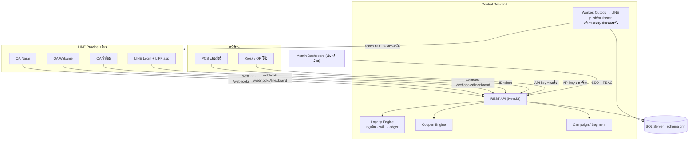
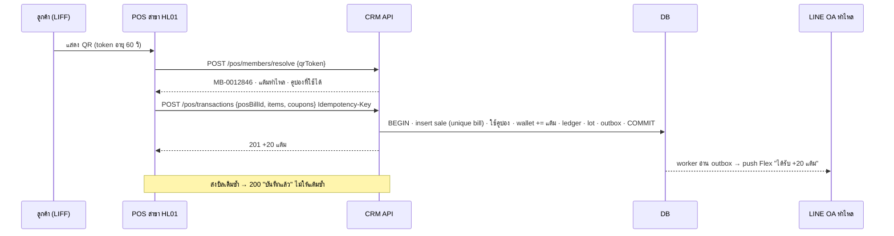

# Group CRM: ระบบสมาชิกหลายแบรนด์ หลายสาขา บน LINE OA

เอกสารนี้ต่อยอดจาก 2 งานที่ออกแบบไว้แล้ว:

- **ระบบสมาชิกหลายแบรนด์ 3 รูปแบบ** (สไลด์): เลือก **แบบ C** คือแยก LINE OA ตามแบรนด์ แต่รวมระบบสมาชิก 1 คนมี 1 Member ID และแต้มแยกกระเป๋าตามแบรนด์
- **HumLai LINE OA CRM** (แคนวาส): Rich Menu หน้าเดียว 4 ปุ่ม, แชท + Flex, LIFF สมัคร/บัตร/คูปอง/แลกแต้ม/ประวัติ และหน้าสั่งอาหารที่ใส่เลขสมาชิกก่อนสั่ง

งานนี้ขยายหน้าจอในแคนวาสจากแบรนด์เดียวให้รองรับหลายแบรนด์ และออกแบบระบบหลังบ้านที่อยู่เบื้องหลัง ดูเดโมที่ใช้งานได้จริงใน [`demo/`](../demo/index.html)

---

## 1. หลักการที่ล็อกไว้

| เรื่อง | การตัดสินใจ |
|---|---|
| ตัวตนลูกค้า | 1 คน = 1 `MemberId` (`MB-0012846`) ใช้ได้ทุกแบรนด์ |
| แต้ม | แยก **กระเป๋าต่อแบรนด์** (Narai / Wakame / หำไหล) แลกข้ามแบรนด์ไม่ได้ (เฟส 1) |
| ช่องทาง | LINE OA แยกต่อแบรนด์ ทุก OA + LINE Login อยู่ **Provider เดียวกัน** ลูกค้าจึงได้ `userId` เดียวกันทุก OA |
| แอปลูกค้า | LIFF app **ตัวเดียว** เปิดด้วย `?brand=<id>` เพื่อเลือกธีมและกระเป๋าเริ่มต้น |
| ความยินยอม | Privacy Notice ระดับเครือ (ครั้งเดียว) + Marketing consent **แยกรายแบรนด์** |
| แต้มเก็บแบบ | Ledger (สมุดบัญชี) + Lots (วันหมดอายุรายล็อต) ห้ามแก้ยอดตรง |
| ความถูกต้อง | ทุกการเพิ่ม/ตัดแต้มเป็น Atomic Transaction + Idempotency Key |

## 2. สถาปัตยกรรม

| ส่วน | เทคโนโลยีที่เสนอ | หมายเหตุ |
|---|---|---|
| LIFF ลูกค้า | React + LIFF SDK (หรือ LINE MINI App) | เดโมเขียนเป็น HTML/JS ล้วน เพื่อให้เปิดดูได้ทันที |
| Admin / เว็บพนักงาน | React + ตารางข้อมูล | ล็อกอินด้วย LINE Login หรืออีเมลองค์กร |
| API | Node.js / NestJS | ตรวจสิทธิ์ทุก endpoint ฝั่ง server |
| ฐานข้อมูล | SQL Server (schema `crm` แยกจาก `dbo` ของ POS เดิม) | ดู [`db/schema.sql`](../db/schema.sql) · ถ้าใช้ Express ระวังเพดาน 10 GB |
| คิว | Outbox table + worker (หรือ Redis/BullMQ) | ส่ง LINE หลัง commit เท่านั้น, retry ได้ |
| Secret | Key Vault / env | channel secret & token แยกต่อ OA |

## 3. การตั้งค่า LINE

1. สร้าง/ย้าย OA ทั้ง 3 บัญชีให้อยู่ **Provider เดียว** (ถ้าอยู่คนละ Provider ระบบจะเห็นลูกค้าคนเดิมเป็นคนละคน)
2. ใน Provider เดียวกันสร้าง **LINE Login channel 1 อัน** + **LIFF app 1 ตัว** (`https://liff.line.me/{LIFF_ID}`)
3. แต่ละ OA ตั้ง Webhook URL ของตัวเอง: `https://crm.example.com/webhooks/line/{brandId}`
   - ตรวจ `X-Line-Signature` ด้วย channel secret **ของแบรนด์นั้น**
   - เก็บ `webhookEventId` ใน `crm.WebhookEvents` เพื่อทิ้ง event ซ้ำ
4. Rich Menu หน้าเดียว 4 ปุ่ม (layout เดียวกับแคนวาส) แต่ละ OA ใช้สีแบรนด์ของตัวเอง:

| ปุ่ม | Action |
|---|---|
| สมาชิก (ใหญ่ซ้าย) | URI `https://liff.line.me/{LIFF_ID}?brand={brandId}` |
| โปรโมชั่น | Message `โปรโมชั่น` → reply Flex carousel ของแบรนด์ |
| สาขา | Message `สาขา` → reply Flex รายชื่อสาขาของแบรนด์ เวลาเปิด-ปิด โทร แผนที่ |
| ติชม | Message `ติชม` → ข้อความ + Quick Reply ให้คะแนน (+5 แต้ม) แล้วส่งต่อแอดมินใน OA Chat |

## 4. หน้าเว็บฝั่งลูกค้า (LIFF)

ทุกหน้ามาจากแคนวาส HumLai เพิ่มสิ่งที่ต้องมีเมื่อมีหลายแบรนด์:

| หน้า | ของเดิมในแคนวาส | เพิ่มสำหรับหลายแบรนด์ |
|---|---|---|
| สมัคร | ชื่อ, เบอร์ + OTP, วันเกิด, สาขาประจำ, PDPA, รับข่าวสาร | สาขาประจำกรองตามแบรนด์ที่เข้ามา · ความยินยอมการตลาดผูกกับแบรนด์ · ถ้าเบอร์ที่ยืนยัน OTP มีบัญชีอยู่แล้ว → **ผูก LINE กับบัญชีเดิม** แทนสร้างใหม่ |
| บัตรสมาชิก | เลขสมาชิก, แต้ม, ระดับ, QR/บาร์โค้ดเปลี่ยนทุก 60 วิ, คูปองใกล้หมด | แถบสลับแบรนด์ด้านบน (แสดงแต้มแต่ละแบรนด์) · ธีมสีตามแบรนด์ · กล่อง "แต้มแยกตามแบรนด์" |
| คูปอง | พร้อมใช้/ใช้แล้ว/หมดอายุ, กรอกโค้ด, แสดงรหัสให้พนักงาน | กรองตามแบรนด์ที่เลือก · โค้ดคูปองขึ้นต้นด้วยรหัสแบรนด์ (`HL-`, `NR-`, `WK-`) |
| แลกแต้ม | หมวด, ปุ่มแลก/ขาดอีก X, ยืนยัน | รางวัลและแต้มเป็นของแบรนด์ที่เลือกเท่านั้น |
| ประวัติ | บิล, ใบเสร็จ, ขอใบกำกับภาษี | กรองตามแบรนด์ · เพิ่มมุมมอง "สมุดแต้ม" (ledger) |
| ข้อมูลของฉัน | – | เปิด/ปิดรับข่าวสารแยกรายแบรนด์ · เห็นว่าเป็นเพื่อน OA ไหนแล้ว |
| Kiosk / QR โต๊ะ | ใส่เลขสมาชิก/เบอร์ → ยืนยัน → เลือกคูปอง → เมนู | ใช้เลขเดียวกันได้ทุกแบรนด์ · คูปองที่แสดงเป็นของแบรนด์สาขานั้น |

## 5. ระบบหลังบ้าน

### 5.1 เมนูและสิทธิ์

| เมนู | Super Admin | Marketing กลาง | Brand Manager | Branch Manager | Cashier |
|---|---|---|---|---|---|
| ภาพรวม (KPI) | ทั้งเครือ | ทั้งเครือ | แบรนด์ตัวเอง | แบรนด์ของสาขา | – |
| สมาชิก + มุมมอง 360° | เห็นเบอร์เต็ม | ปิดบังเบอร์ | แบรนด์ตัวเอง | แบรนด์ของสาขา | ค้นหาตอนขายที่ POS |
| คำขออนุมัติแต้ม | ✓ | – | ✓ | ✓ ตามวงเงิน | ส่งคำขอได้ |
| กฎแต้ม & ระดับ, ของรางวัล | ✓ | ✓ | แบรนด์ตัวเอง | – | – |
| แคมเปญ / บรอดแคสต์ | ✓ | ✓ | แบรนด์ตัวเอง | – | – |
| LINE OA & Rich Menu | ✓ | ✓ | – | – | – |
| แบรนด์ & สาขา, พนักงาน & สิทธิ์, API log | ✓ | – | – | – | – |
| Audit Log | ✓ | ✓ | – | – | – |

ขอบเขตเก็บใน `crm.StaffScopes` (group / brand / branch) ทุก query ฝั่ง server ต้องกรองด้วย scope ของผู้ใช้ ไม่ใช่แค่ซ่อนเมนู

### 5.2 KPI ใน Dashboard

สมาชิกไม่ซ้ำคน · สมาชิกใหม่ 30 วัน · Active 30 วัน · Repeat rate · ความถี่ซื้อ · ยอดเฉลี่ยต่อบิลสมาชิก · **ลูกค้าข้ามแบรนด์** · สัดส่วนยอดขายจากสมาชิก · แต้มแจก / ถูกแลก / ค้าง · ผลงานรายสาขา (นับเฉพาะบิลชำระสำเร็จ)

### 5.3 Segment ที่ส่งแคมเปญได้ (เฟส 1)

ทุกคนที่ติดตาม OA + ยินยอม · สมาชิกใหม่ 30 วัน · Gold ขึ้นไป · ไม่มาเกิน 30 วัน · **ลูกค้าแบรนด์อื่นที่ยังไม่เคยมาแบรนด์นี้** (cross-sell ที่แบบ C ทำได้)
ระบบตัดคนที่บล็อก OA หรือไม่ยินยอมของแบรนด์นั้นออกเสมอ และส่งด้วย token ของ OA แบรนด์นั้น (multicast ทีละ 500)

## 6. API

### ลูกค้า (LIFF) · ยืนยันด้วย LINE ID token

| Method | Path | ทำอะไร |
|---|---|---|
| GET | `/liff/me?brand=` | ตรวจ ID token → คืนสมาชิก หรือ 404 ให้ไปหน้าสมัคร |
| POST | `/auth/otp` · `/auth/otp/verify` | ส่ง/ยืนยัน OTP เบอร์โทร |
| POST | `/members` | สมัคร (แต้มต้อนรับ + คูปองบิลแรกของแบรนด์ที่สมัคร) |
| POST | `/members/link` | ผูก LINE กับสมาชิกเดิมหลังยืนยัน OTP |
| GET | `/members/me/wallets` | แต้ม + ระดับทุกแบรนด์ |
| GET | `/members/me/qr` | token อายุ 60 วิ (HMAC ของ memberId + ช่วงเวลา) |
| GET | `/members/me/coupons?brand=&status=` | คูปอง |
| POST | `/members/me/coupons/claim` | กรอกโค้ด |
| GET | `/rewards?brand=` | รางวัล |
| POST | `/members/me/redemptions` | แลกแต้ม (lock wallet, Idempotency-Key) → ออกคูปอง |
| GET | `/members/me/transactions?brand=` · `/members/me/ledger?brand=` | ประวัติ |
| PATCH | `/members/me/consents` | เปิด/ปิดรับข่าวสารรายแบรนด์ |
| POST | `/members/me/tax-invoice-requests` | ขอใบกำกับภาษี (ดึง `dbo.TaxCustomers` เดิม) |

### หน้าร้าน (POS / Kiosk) · API key ต่อเครื่อง ผูกกับสาขา

| Method | Path | ทำอะไร |
|---|---|---|
| POST | `/pos/members/resolve` | จาก QR token / เลขสมาชิก / เบอร์ → สมาชิก + แต้มแบรนด์นี้ + คูปองที่ใช้ได้ |
| POST | `/pos/coupons/validate` | ตรวจคูปองกับ server ก่อนหักส่วนลด |
| POST | `/pos/transactions` | บิลชำระสำเร็จ (Idempotency-Key = เลขบิล) → แต้ม + ใช้คูปอง + push Flex |
| POST | `/pos/refunds` | คืนเงินทั้งหมด/บางส่วน → หักแต้มคืนตามสัดส่วน คืนคูปองที่ยังไม่หมดอายุ |
| POST | `/pos/point-requests` | ขอแต้มย้อนหลัง (ลืมแจ้งสมาชิก) |

### หลังบ้าน · SSO + RBAC

`/admin/dashboard` · `/admin/members` · `/admin/members/:id` · `/admin/point-adjustments` (+`/approve` `/reject`) · `/admin/brands/:id/earn-rule` · `/admin/rewards` · `/admin/campaigns` (+`/send`) · `/admin/line-channels` · `/admin/branches` · `/admin/staff` · `/admin/audit-logs`

### LINE

`POST /webhooks/line/:brand` รับ follow / unfollow / message / postback ของ OA แบรนด์นั้น

## 7. ลำดับการทำงานหลัก

### สะสมแต้มที่แคชเชียร์

### ลูกค้าเปิด OA แบรนด์ที่สอง

follow event → หา `MemberLineIdentities` จาก userId → พบ → อัปเดต `MemberBrandLinks.FollowStatus='follow'` และทักทายพร้อมบอกว่าใช้เลขสมาชิกเดิมได้เลย ไม่ต้องสมัครซ้ำ (consent การตลาดของแบรนด์ใหม่ยังเป็น "ไม่" จนลูกค้ากดยอมรับ)

## 8. กรณีพิเศษ

| กรณี | ระบบจัดการ |
|---|---|
| POS ส่งบิลซ้ำ / เน็ตหลุดแล้ว retry | Unique `(BranchId, PosBillId)` + Idempotency Key → ไม่ให้แต้มซ้ำ |
| แลกพร้อมกันสองเครื่อง | lock แถว wallet + `CHECK (Balance >= 0)` |
| ส่งภาพ QR/คูปองให้คนอื่น | QR หมุนทุก 60 วิ · คูปองตรวจสถานะที่ server ทุกครั้ง ใช้แล้วใช้ซ้ำไม่ได้ |
| คืนเงิน | หักแต้มคืนตามยอดที่คืนจริง · คืนคูปองที่ยังไม่หมดอายุ |
| ลืมแจ้งสมาชิก | ขอย้อนหลังได้ตาม `BackdateDays` · ผู้ขอกับผู้อนุมัติต้องเป็นคนละคน |
| ลูกค้าบล็อก OA | เก็บสถานะใน `MemberBrandLinks` · ตัดออกจากแคมเปญ · ข้อมูลสมาชิกยังอยู่ |
| บัญชีซ้ำ | รวมได้หลังยืนยันความเป็นเจ้าของด้วย OTP เท่านั้น · ledger ย้ายด้วย entry `merge` |
| สาขาไม่มี API | เว็บพนักงานกรอกเลขบิล+ยอด แล้วกระทบยอดกับรายงาน POS รายวัน |
| LINE ส่ง webhook ซ้ำ | ตรวจ `webhookEventId` ใน `crm.WebhookEvents` |

## 9. เดโมในโปรเจกต์นี้

เปิด `demo/index.html` ได้เลย ไม่ต้อง build (ข้อมูลจำลองเก็บใน localStorage ของเบราว์เซอร์ กด "รีเซ็ตเดโม" เพื่อเริ่มใหม่)

| แท็บ | ลองทำ |
|---|---|
| ลูกค้า (LINE) | เลือก OA → กด Rich Menu → สมัคร → ดูบัตร QR / แต้มทุกแบรนด์ → แลกแต้ม · ด้านขวาแสดง API/Webhook ที่ backend ได้รับจริง |
| หน้าร้าน POS | เครื่องแคชเชียร์: สแกน QR จากมือถือเดโม → ใส่เมนู → เลือกคูปอง → ปิดบิล → ลองส่งซ้ำ / คืนเงิน · Kiosk: ใส่ 0012845 หรือ 0812345678 |
| หลังบ้าน | สลับ "เข้าใช้ในฐานะ" เพื่อดูสิทธิ์ · แก้กฎแต้ม (มีผลกับ POS ทันที) · ส่งแคมเปญ → ข้อความเข้าแชทลูกค้า · อนุมัติคำขอแต้ม |

`demo/store.js` คือ mock backend ฟังก์ชันใน `API.*` ตรงกับ endpoint ในหัวข้อ 6 เพื่อใช้เป็นสเปกตอนเขียน backend จริง

## 10. แผนพัฒนา

| เฟส | ขอบเขต |
|---|---|
| 1 · MVP | Provider/OA/LIFF, สมัคร + OTP, Member ID กลาง, กระเป๋าแยกแบรนด์, เชื่อม POS (`/pos/transactions`, `/pos/refunds`), รางวัล/คูปอง, Kiosk ใส่เลขสมาชิก, Admin: ภาพรวม/สมาชิก/อนุมัติ/กฎแต้ม/รางวัล/Audit |
| 2 · CRM & Marketing | แคมเปญตาม segment, คูณแต้ม, คูปองวันเกิด, แจ้งแต้มใกล้หมด, cross-brand report |
| 3 · Advanced | ระดับสมาชิกเต็มรูปแบบ, Referral, Automation, แต้มกลางเครือ / แลกข้ามแบรนด์ |

## 11. ต้องให้ผู้บริหารตัดสินก่อนเริ่มเขียนจริง

1. อัตราแต้มของแต่ละแบรนด์ (เดโมใช้ Narai/Wakame 100 บาท = 1, หำไหล 25 บาท = 1 เป็นตัวเลขสมมติ)
2. ยอดที่ใช้คิดแต้ม รวม VAT / ส่วนลด หรือไม่
3. อายุแต้ม
4. รายการรางวัล แต้มที่ใช้ และโควตา
5. คูปองใช้ทันทีหรือเก็บไว้ได้ และการคืนแต้มเมื่อคูปองหมดอายุ
6. POS แต่ละแบรนด์เชื่อม API ได้หรือไม่
7. OA ทั้ง 3 อยู่ Provider เดียวกันแล้วหรือยัง
8. ขอบเขตการใช้ข้อมูลข้ามแบรนด์ใน Privacy Notice
